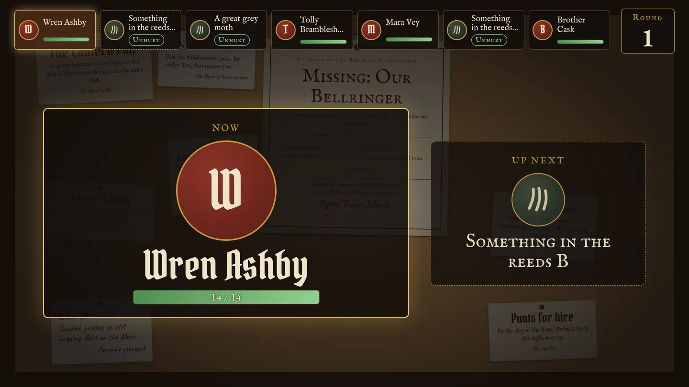

# Candlefair

**A free companion for D&D at the table.** The TV becomes the table, every player plays from their phone, and the DM runs the night from one console that remembers every name, place and loose thread. It runs next to D&D Beyond and covers what it doesn't.

**Try it:** [dnd.calebs.garden](https://dnd.calebs.garden). Start a campaign from the front page; there are no accounts and nothing to install.



- **The TV** shows the map with fog of war, fights, scenes, handouts and every dice roll, live (3D dice included), with sound made in the browser.
- **Phones** hold each player's character sheet, gold, journal and what the party has discovered. Players buy from shops, roll on the TV and get secret whispers from the DM.
- **The DM console** runs the bank, shops, fights, the story and its people and places, and remembers past sessions so nobody keeps the books.
- **Spoiler safe:** DM-only data never leaves the campaign's room for a TV or phone. Each screen's data is built from an allow-list and tested.

**How it's built:** one Cloudflare Durable Object per campaign (in-memory game, its own SQLite, WebSocket pushes), a Worker in front, R2 for images, React + Vite on the client. Idle campaigns hibernate and cost nothing. Around 1,000 tests run on every PR. More in [How it's built](#how-its-built), [docs/capacity-report.md](docs/capacity-report.md) and [docs/security-audit.md](docs/security-audit.md).

Made by [Caleb](https://calebs.garden) for a home game called *Tales from the Flickering Candle*, and free for any table.

The rest of this file is the manual: [how access works](#how-access-works), [running it locally](#run-it-locally), [deploying](#deploy-cloudflare-workers--durable-objects--r2), and every feature.

## Starting a campaign

Anyone can start a campaign from the front page. Each campaign has a short code (like `wick7kq`) and its own DM key.

A new campaign starts blank, from a saved preset, or from the premade starter **The Bell under Marrowmere**: an original lake-town campaign with a map, portraits, an Arrival intro, three shops, people and places to discover, two monsters, job flyers, a rumor table and the episode-one run sheet "The Bell That Rang Twice". Its content is in `src/server/seed-marrowmere.ts` and its pictures in `public/art/marrowmere/`. Campaigns that started from Candlefair (before this) keep their Candlefair content, and **Reset everything** still returns them to it.

| Who | Open | What it does |
| --- | --- | --- |
| Anyone | `https://dnd.calebs.garden/` | Join a table with its campaign code, or start a new campaign. |
| The DM | the private DM link shown when the campaign was made (`/?game=CODE&player=DM#key=…`) | Switch scenes, run the bank, edit shops and scenes, manage players. |
| The TV | `/?game=CODE&player=TV` | Full-screen scenes, the party purse, the shop when it's open. Controls only appear when the mouse moves. |
| A player | `/?game=CODE&player=Sam` (or `/?game=CODE` to type a name) | Their gold, the party purse, the shop, their history. |

## How access works

- **Starting a campaign** (front page → *I'm a DM: start a new campaign*) makes a new campaign and a random DM key, and shows the DM's private link once. Only a hash of the key is stored. There are no accounts and no reset: if the DM loses every copy of the link, the campaign can't be run again. You can pick your own campaign code or get a random one.
- **The DM** opens that link. The key sits after the `#`, so it's never sent to the server or logged. It's saved on the device and removed from the address bar, so `?game=CODE&player=DM` alone works afterwards. **DM view → Game → Links** copies the link again or makes a new key (old links stop working everywhere).
- **Players** need no account. A new `?player=<name>` creates that player on the spot, and they show up in the DM view straight away. `Player1`, `player 1` and `PLAYER-1` are the same person.
- **Locking a name:** add `&key=anything` the first time (or press "Lock my name" on the player page). After that, that name only opens with that key. The DM can reset a lock.
- **Seats:** the table seats 6 by default; change it under Players. Once every seat is taken, a new name knocks instead of joining, and you can still let them in. Players marked "left the table" don't hold a seat.
- **Griefing:** players can't move money themselves; only the DM can. If silly names start appearing, tick **Close the door** in the DM view: new names then knock, and you choose who to let in.
- **The TV** is read-only.

### Spoiler safety

DM-only data never leaves the campaign's room for the TV or a phone. The room builds each screen's data from an allow-list (`src/shared/projection.ts`); the UI doesn't just hide things.

- **Reveal scenes** aren't sent to the TV at all until the DM shows them.
- **The merchant's sigil** isn't in the browser code at all. `/api/art/merchant-sigil` serves it only while its scene is live, or to the DM.
- **Run sheets** (episodes, beats, quick notes, recaps) never reach the TV or a phone. Only what a beat's actions do (a scene switch, the purse) does. The one exception is a recap you choose to show as "Previously on…", and only while it's showing. The seed episode lives in `src/server/` so its text isn't even in the browser code.
- **Never sent to the TV or players:** hidden prices (they see `??? gp`), DM notes, name-lock hashes, last-seen times, hidden map locations and map DM notes and links, hidden tokens, and any part of a map still under fog (not even the image).

Tests in `tests/projection.test.ts` put a marker string in every DM-only field and check it never appears in the TV or player data.

## Arrival: the intro texted before session 0

Each player gets a private link, `/arrive/<code>`, from the DM view's **Arrival** tab (**Copy text** copies a ready-to-send message; edit the message there). On a phone it plays a short tap-through intro (their arrival in Candlefair by ship), then lands on their seat: a character name, an optional "Why did you get on that boat?" line, and **Take a seat**. After that the link opens straight on the seat page, with **Replay intro**.

For first-time players, the seat page has **Pick a starting point**: six kinds of hero in plain words (The Protector, The Sneak, The Spellcaster, The Healer, The Wild One, The Charmer), each with what you do on your turn and the D&D Beyond recipe (2024 rules: class, species, background, best ability). **Help me choose** asks three questions and suggests one. Picking fills in a sample name and line they can change; the pick shows on their row in the Arrival tab. Edit the cards in `src/shared/starters.ts`.

- **The DM's Arrival tab** shows, per player: link copied, intro opened, finished, seat claimed, character name. **Reset** puts a player back to new (same link). **Lock seats** stops name changes.
- **The intro on the TV:** **Play intro on TV** in the Arrival tab (or `intro` on the quick bar or in a run sheet) plays the same intro on the TV, laid out for a wide screen. The boat's pictures sit in a tall frame with the words typed out beside them; a DM's slides fill the screen with their **TV picture** (a landscape version, added per slide in the Intro card) or frame the phone picture beside the words when there isn't one; a clip plays full screen. It moves on by itself; under the TV preview the DM gets Back, Pause, Next, From the top and The Table. A video moves on after its length (measured on upload); an older clip without one waits for Next. The phone links are untouched. Code: `src/client/scenes/IntroScene.tsx`, `src/client/arrival/tvIntro.ts`.
- **The Table** on the TV (press `T`, or the button in the Arrival tab) shows one candle per player. Seats light live as players claim them; a QR code in the corner cycles through whoever hasn't claimed yet. When the last seat lights, every candle flares and the title fades in.
- **The generic link** `/arrive` plays the intro and then asks for the link the DM sent. It can't claim a seat.
- **Link previews** (iMessage, Android Messages) show *Tales from the Flickering Candle*, *Four days out of Baldur's Gate…* and `public/arrival/og.jpg`. They're identical for every player; the words are the `<meta>` tags at the top of `arrive.html`.
- **Editing the words:** everything the intro says is in `src/client/arrival/content.ts` (`{SHIP}`, `{CAPTAIN}`, `{CHARACTER}` placeholders; the ship and captain names are at the top).
- **Sound** is off by default, with a toggle that's remembered per device. The waves, creaking, wind, door and hearth are made in the browser, so there are no files to download. To use recordings instead, put them in `public/arrival/sounds/` and list them in `SOUND_FILES` in the content file.
- **Spoiler safety:** the Arrival page is its own part of the site with its own small bundle; it loads none of the main app's code or styles. `/api/arrival` sends only the seat names and the player's own progress.

## Secret whispers

A private note from the DM to one player, or a few: "You notice the baker's hands are shaking." **Whisper** (or `W`) is in the DM bar, in run-game mode and on the fight screen; a player's ⋯ menu on the Players page opens it picked for them. Tick who hears it, type, press Enter.

- **Only they get it.** The TV never does, and other phones don't either. Sent to several, each phone gets its own copy without the other names (write "you both…" if you want them to know).
- **Sealed until read.** The phone shows *A whisper from the DM · Tap to read* (and buzzes, or chimes when that player has device sounds on), so a neighbour glancing over sees nothing. The DM's list says who has read it.
- **Answer quietly.** A player can send one short line back (and change or take it back). A dot on the Whisper button means an answer is waiting.
- **Take back** removes it from every phone it went to. A phone keeps its last 30; older ones are under *Your character → Whispers from the DM*. Code: `src/shared/whispers.ts`. It's a feature switch ("Secret whispers") on the Features page.

## Sound and the soundboard

Sound plays from the TV. Every sound is made in the TV's browser with Web Audio (oscillators, filtered noise, plucked strings), so there are no audio files to download, host or license, and nothing is streamed from the server. The music is composed as it plays from a few rules (a key, a chord pattern, a rhythm), so it doesn't loop exactly. Code: `src/client/sound/` (engine, layers, one-shots), the catalog in `src/shared/sound.ts`.

- **The soundboard:** the **Sound** button in the DM bar (also on the fight screen and in run-game mode). **Mixes** crossfade everything at once (Busy tavern, Quiet inn, Battle, Night camp, Storm, Dungeon, Wizard's study…). **Layers** has every loop with its own volume: music (Tavern jig, Quiet lute, On the road, Battle drums, Tension, Wonder, Sorrow) and ambience (Tavern crowd, Hearth fire, Rain, Wind, Thunderstorm, Forest birds, Night crickets, Ocean waves, River, Market bustle, Cave drips, Crypt, Ticking clock). **Effects** are one-shots: sword hits, arrows, roars, deaths, spells, dice, coins, fanfares, doors, bells, thunder, a war horn, a wolf howl… Fade picks how long changes take (1, 3 or 8 seconds). The TV volume and mute sit at the top.
- **Moments make sounds** (on by default): dice rattle and land with the 3D dice (a natural 20 gets a sting, a natural 1 the sad trombone), a fight opens with a war horn, turns and rounds get a drum, crits clash, monsters die, a fallen player gets a heartbeat, and the end card plays victory or defeat. Rank-ups get a fanfare, level-ups a flourish, reveals a chime, handouts and maps a page turn. Ambient scenes bring their own bed (the campfire crackles, the coast has waves and gulls), and a fight brings battle drums. The DM's own layers always win over a scene's bed.
- **The Table fills up:** while The Table is on the TV, the tavern music and the crowd grow with every seat claimed, each seat lights with a little chord, and the last one gets a cheer. The stinger has its own score.
- **Run sheets:** `sound: busy tavern` (a mix), `sound: night crickets` (one layer), `sound: layer/rain` (just that layer when a mix has the same name), `sound: off`, and `sfx: war horn`. Add `(tap)` to either (`sfx: monster roar (tap)`) for a **Play** button on the beat in run-game mode instead of playing as you land. In the Episodes page, **+ Add to this beat** opens a picker with tabs (Show on TV by kind, Music & ambience, Sound effect with "Play as I land" or "A button I tap", Fight, Bank) and a search box across all of it.
- **The click:** browsers won't let a page make sound until someone clicks or presses a key on it. The TV remembers that sound is on, but after a reload it may need one click; when the DM is using the soundboard and the TV can't play yet, it shows **Click anywhere for sound**. A TV inside the DM's practice preview stays quiet. **Hear it on this device too** on the soundboard plays a copy on the DM's device (for prep with headphones).

## Run it locally

```bash
npm install
npm run dev       # http://localhost:5173, with the Worker, rooms and image storage running locally
```

Open http://localhost:5173/, start a campaign, and open the DM link it shows. Local data (campaigns and uploaded images) lives in `.wrangler/state/`; delete that folder to start over.

```bash
npm test          # money, ledger, permissions, spoiler filtering, saves, campaigns
npm run typecheck
npm run build     # what gets deployed: dist/client (the pages) and dist/candlefair (the Worker)
```

## Deploy (Cloudflare Workers + Durable Objects + R2)

One-time setup, in the Cloudflare dashboard of the account that already holds `calebs.garden`:

1. **Turn on R2.** R2 Object Storage → Purchase/Enable. The free tier covers 10 GB, but Cloudflare asks for a payment method. Create a bucket named `candlefair-files`.
2. **Connect the repo.** Workers & Pages → Create → Import a repository → `DnDBeyondTheWick`. Build command `npm run build`, deploy command `npx wrangler deploy`. Every push to `main` then deploys by itself. (Or deploy by hand with `npx wrangler login` then `npm run deploy`.)
3. **Domain.** The Worker → Settings → Domains & Routes → Add → Custom domain → `dnd.calebs.garden`. Remove the old `dnd` CNAME that pointed at Vercel first.
4. **Plan.** On the free plan, hitting a daily limit makes changes fail until midnight UTC. Before inviting the public, switch to Workers Paid ($5 a month): Workers & Pages → Plans.
5. Turn off the Vercel project, Upstash and Blob once the new site works.

Everything the Worker needs is in `wrangler.jsonc`: the `ROOMS` Durable Object (one per campaign), the `FILES` R2 bucket and a limit of 5 new campaigns a minute per address. There are no secrets to set.

### Running costs

- **Each campaign is one Durable Object** that holds its game in memory and saves to its own SQLite. A click is one saved row (plus a row per ledger line) and no reads. Screens get their new view pushed over a WebSocket, and pushes are free.
- **Idle campaigns hibernate** and cost nothing, even with a TV connected all week. A campaign untouched for six months is deleted, with its images.
- **Rough capacity:** the free plan allows about 30 busy game nights a day; the $5 plan about 6,000 a month, then roughly $3 per 1,000 more. Images: 10 GB free, downloads free.
- Check Workers & Pages → the Worker → Metrics after your first session.

## The TV on a Roku

Roku has no usable web browser, so the TV page runs on a laptop and shows on the TV:

- **HDMI (most reliable):** plug the laptop into the TV and set the TV as a second screen.
- **Screen mirroring:** Roku supports Miracast. On Windows press Win+K and choose **Extend**. On Linux, GNOME Network Displays can work, but it's hit-or-miss.
- **No laptop:** a streaming stick with a browser (e.g. a Fire TV Stick with Silk) can open `?player=TV` by itself.

In the DM view, **Open TV window** pops the TV page out. Drag it onto the TV and press **F** for fullscreen.

## Keys

| Where | Keys |
| --- | --- |
| DM view | `D` dice · `0`–`9` the quick bar · `/` find anything to show · `←` `→` step through the quick bar (while the shop is open: flip shops) · `S` shop on the TV · `P` purse · `B` bank · `T` The Table (Arrival) · `I` requests from phones · `L` map legend · `Esc` closes the requests drawer, then the shop, then zooms a map back out |
| Table map | drag a token to move it · `←` `↑` `→` `↓` move the selected token one square · `H` hide or show it · `Delete` removes · `Esc` deselects, then closes |
| Map editor | click the map to drop a pin · drag to move · `←` `↑` `→` `↓` nudge (Shift: bigger steps) · `Delete` removes · `Ctrl+Z` undo · `Esc` deselects, then closes |
| Fight screen | `D` dice · `Space` next turn · `Shift+Space` previous · digits type an amount · `Enter` damages the picked rows · `Shift+Enter` heals them · `Esc` clears the amount, then the picks |
| Run-game mode | `D` dice · `Space` or `→` next beat · `Shift+Space` or `←` back · `0`–`9` `/` `S` `P` `T` as above · `Shift`+`1`–`9` shows what this beat mentions (the "On this beat" buttons) · `B` opens the bank on top · `I` requests · `Esc` closes whatever is on top |
| TV | `F` fullscreen · `H` hide the control bar |

## How it's built

- **Vite, React 19, TypeScript** for the pages: `index.html` (the TV, DM, player and front page, picked by `?player=`) and `arrive.html` (the Arrival intro, its own small bundle).
- **A Cloudflare Worker** (`worker/index.ts`) is the front door: it serves the pages, starts campaigns, stores images in R2 and passes every other `/api/` call to the campaign's room.
- **One Durable Object per campaign** (`worker/room.ts`) holds the game document, the ledger and the DM key's hash in SQLite. Requests to a room run one at a time, so two purchases can't spend the same gold.
- **Every write goes the same way:** the room checks who's asking, then runs a pure rules function (`src/shared/reducer.ts`) and saves. The HTTP API itself is plain `Request → Response` code in `src/server/api.ts`, so tests run it against an in-memory store.
- **Live updates:** each screen keeps one WebSocket to its room. After each save the room builds every connected screen's own filtered view and pushes it. If the connection drops, the screen keeps showing what it has and reconnects quietly.
- **Money is integer copper** everywhere (`src/shared/money.ts`) and displays as `12 gp 5 sp 3 cp`. Gold "+25 gp" floats on the TV come from comparing balances, so they still show after a reconnect.
- **Seed data** is in `src/shared/seed.ts`. The sigil is in `src/server/art/`.

```
index.html, arrive.html   the two pages
worker/                   the Worker (front door) and the campaign room
src/shared/               rules, money, seed data, per-screen views (used by the room, the pages and tests)
src/server/               the API, auth, game service (runs inside the room; never in the browser)
src/client/               TV, DM, player and Arrival screens
tests/                    vitest
```

## At the table

- **Gold lives here, not on D&D Beyond.** Players keep D&D Beyond's coins at 0. Anything bought here, they add to their D&D Beyond inventory themselves; the ledger keeps the purchase history.
- **Heroic Inspiration:** tap the d20 beside a player's name in the Bank (or "Inspiration" on their card under Players). A gold d20 then shows beside their name in the TV purse; tap again when it's spent.
- **Maps:** a Map scene shows an uploaded image letterboxed on the TV, with numbered wax-seal locations you place yourself (Maps & props → Pins, or Edit map under the preview). Each location has a seal label (up to 4 characters), name, type, description, private DM notes, and an optional link (a shop, an NPC portrait or another map). Only **discovered** locations reach the TV; hidden ones and every DM note stay on the server. While a map is on the TV, tap a location to zoom the TV to it (tap again or Esc to zoom out), reveal it with a "Discovered: …" banner or quietly, and toggle the legend with L. **Dot size** (a slider in the map editor and under the preview) shrinks or grows that map's dots, from 25% to 200%. With the "numbers only" legend, names aren't sent to the TV until you focus a location. Games created before maps existed get an **Add the Candlefair and Sword Coast maps** button under Maps & props.
- **Pixel-art looks:** players make a little pixel-art character on their phone (**Character** tab, or **Your character** when sheets are off): build and skin, ears, eyes, mouth, marks, hair, beard, outfit, cloak, headgear, a weapon and an off-hand item, horns, tail, wings, a pet, a stand and a backdrop, each with arrows and colour swatches, plus dice to randomize everything or one tab. It's saved as a tiny recipe of numbers (no image upload) and drawn crisp in the browser: inside their token's ring, beside their name on the TV purse and turn order, and on the DM's player list. The DM can make or change one from the player's drawer, and **Make a pixel portrait** on a Discovery entry turns a look into that NPC's picture (uploaded like any image, recipe kept so it can be edited). All the art is drawn in code. Code: `src/shared/look.ts` (parts and colours), `src/shared/lookArt.ts` (the drawing), `src/client/ui/LookEditor.tsx`.
- **Tokens (the table map):** **Table map** under the preview (or **Map** on the fight screen) opens the map full-screen with tokens. **Add party** puts a token on it for everyone at the table (in their own colour, with their character's initials and first name); **Add monster** (starts hidden) and **Add NPC** add more. Drag a token and the TV follows when you let go. A token can have up to 3 letters, a colour, a size (Tiny to Gargantuan), a picture, Hidden (only the DM sees it; hidden tokens never leave the server) and Locked (players can't move it). **Grid:** match the map's own squares by dragging across one, or start a plain grid and size it; tokens snap to squares (big tokens to corners), and the lines can show on the TV or only for the DM. **Fights on a map:** with a map on the TV, everyone in the fight gets a token automatically; monster tokens use the TV name (so reveals carry over), hidden foes stay off the TV, and their tokens leave every map when the fight closes. The TV keeps the map bright, with the turn order on top, whose turn it is in a card under the round, and a gold glow on that token. **Next turn** works from the table map too. Code: `src/shared/tokens.ts`, `src/client/dm/TableMap.tsx`.
- **Fog of war:** on the table map, **Fog → Cover the map in fog** cuts the map image into pieces in your browser, stores them, and covers the whole map (cells follow the grid if there is one). Reveal with the **Reveal brush** or **Reveal a box** (drag over a room), cover again with the **Cover brush**, or **Reveal all** / **Cover all**; untick **Fog on** to show the whole map. While fog is on, the TV and phones never get the whole image: only the pieces that touch a revealed square, plus the fog itself. Pins and non-party tokens under fog aren't sent either (the party always shows). If you change the map's image, the TV shows nothing of it until you press **Update for the new image**. Code: `src/shared/fog.ts`, `/api/upload-tiles` in `worker/index.ts`.
- **The map on phones:** while a map is on the TV, players get a **Map** tab with the same map (fog, pins and tokens as the TV sees them). They can pinch or use + and − to zoom, drag to look around, **Find me**, and drag their own token (the TV follows when they let go; snapped to the grid). A token the DM has **Locked** can't be moved from the phone. Once a map has been on the TV, players keep it: the tab becomes **Maps**, with the map on the TV first and every known map after it, to zoom around and tap a location to read about it (tokens only move on the map that's on the TV). Hidden pins, hidden tokens and fog apply there too, and with the numbers-only legend the names stay hidden. To share a map without showing it, or take one back, use **Players can open it on their phones** in the scene editor.
- **Launch VTT:** paste the campaign's D&D Beyond game link under Game. It shows as a Launch VTT button at the top of your view and on every player's phone.

## Shops

- **Every shop starts hidden.** In DM view → Shop, each shop has **Hidden / Everyone / Selected players**.
  - **Hidden:** nobody but the DM sees it.
  - **Everyone:** the whole party gets it, and it can go on the TV.
  - **Selected players:** a secret offer (the Peddler). It's never shown on the TV.
- **Server-side filtering:** hidden shops, hidden items, rumored names and item DM notes never leave the server for anyone who can't see them.
- **Item tiers** (Edit on a card → "Shown as"):
  - **For sale:** players can buy it.
  - **Locked:** visible with its price (or ??? gp) and a reason.
  - **Rumored:** shows "???" and a one-line hint.
  - **Hidden:** not shown at all.
- **Stock** is optional ("1 in stock"); buying takes one, and "When sold out" says what happens next.
- **Special orders:** set "arrives after N sessions". The buyer pays now, and the order arrives by itself when that session starts.
- **Price labels and fine print:** "Free*" with fine print, for the Peddler.
- **Banners:** opening a shop to everyone, or revealing or unlocking an item in an open shop, shows a short banner on the TV and on phones. Tick **Quietly** to skip it.
- **Closed shops** (the Peddler) show only their name and tagline until you untick Closed.
- **Starter catalog:** DM view → Game → **Load the starter catalog** swaps in the latest one, with all shops hidden. Gold and history aren't touched.

## Renown and the bounty board

- **Renown** is one rank for the whole party: Strangers → Known in town → Trusted → Heroes of Candlefair → Famous on the Coast. Set it in DM view → **Board**. Raising it plays a moment on the TV ("Candlefair knows your names"), adds a line to the Chronicle, and opens anything that was waiting on it. Lowering it is quiet, and those things lock again.
- **Renown locks:** any item or storefront can need a rank (Edit → *Needs Renown*). Until the party has it, players see it locked with the rank ("Needs Known in town") and your line underneath. Storefronts show their name and the rank, but no goods.
- **Job flyers** live on the same notice board as player flyers, and the board holds 8 pins in all. Each has a title, who posted it, a few lines, a reward (per person, for the party, or hidden), the Renown it needs, and a paper: scrawled note, merchant's bill, official notice, or sealed envelope (no text at all). Your notes on it (adventure, loot, twists) never leave the DM view.
- **Statuses:** Open → Taken → Done, or Pulled. Jobs belong to the whole party: anyone can tap **Take this job for the party** on their phone (Jobs tab), it comes to your Requests drawer, and everyone's phone shows the party has asked (one ask per job). Taken and done flyers say when, not who: "Taken by the party in Chapter 4", "Completed in Chapter 4" (the session it happened in, or the date before the first session). Jobs above the party's Renown stay readable, stamped "Experienced parties only", with no take button. **Done…** pays the reward to each player at the table by default (a party total is split evenly; type any amount you like); it goes through the ledger once, is written in the Chronicle, and the DONE flyer comes down after the next full session. **Pull and follow up…** replaces a flyer with a new one in the same spot.
- New campaigns start with four job flyers (Artum’s Winterfest job among them), all unpinned. Older campaigns get them once.

## Buying from phones

- **Players ask, you decide.** On their phone a player sees their gold, their *available* gold (gold minus anything waiting), and the shops you've opened to them. They tap an item, pick a quantity if it stacks, add an optional note ("for the bard"), and ask. They can cancel while it's waiting.
- **Holds.** A waiting request holds the gold and the stock, so nobody can ask for more than they have, and two players can't both claim the last lute.
- **The Requests drawer** (`I`, or the Requests button with its badge and a soft chime you can mute): Approve, Decline with a reason they'll see, or **Different price** to type a new total after haggling (the ledger keeps both prices). **Approve all** handles payday. If something no longer works when you approve (they spent the gold, it sold out), it tells you and offers *Approve anyway*.
- **On the TV:** "Mira bought a Shield." (tick *Show purchases on the TV* in the drawer to turn it off). Never for secret shops.
- **Secret sales:** tick it on a shop (the Peddler has it on). Shops shown only to selected players are always secret. Those purchases never reach the TV or other phones.
- **Sending gold:** a player can ask to send gold to another player from the party purse. It goes through the same drawer and shows in both ledgers.
- **One at a time:** untick *Players can ask for several at once* on gear like armor.
- Phones get no push notifications; a banner appears on the page when you decide. Anyone who opens an unlocked name can ask to spend that player's gold, so players are nudged to lock their name; your approval is the safeguard either way.

## Discovery (people, places, shops, monsters, mysteries)

One compendium for everything the party can find: people, places, shops, monsters, mysteries and factions.

- **DM view → Discovery** lists every entry by kind. Each has a stage: **Hidden** (only you see it), **Rumored** (phones and TV see the nickname, or "???", a hint and a silhouette, nothing else), **Met/Found** and **Known**. Revealing any fact makes an entry Known. Changing a stage twice does nothing the second time.
- **Seeded:** Captain Orsa Dell, Mags and Artum (met), Fennick and the baker (rumored), the merchant, the Chef and Bolla (hidden). Seed entries are added to existing games only if missing; "Start fresh" returns every entry to its starting stage. They live in `src/server/` so locked facts and DM notes never ship in the browser code.
- **Pictures:** pick a portrait scene. Portraits are served from `/api/art/…` only once the entry is found, so phones can't guess their way to a face. Rumors show a silhouette: **Make silhouette from portrait** builds one in your browser, or upload one, or use the generic shape for the kind.
- **The TV** plays a short reveal (silhouette, then the picture fills in) when an entry is found or a fact is revealed on the TV, with an optional chime (the speaker toggle on the TV, off by default). Untick "Play stage changes on the TV" to change stages quietly.
- **Relationships:** how they feel about the party (Stranger, Friendly, Ally, Hostile), with an optional override per player shown as a badge on that player's phone.
- **Places** can be tied to a map pin. Hidden hides the pin, Rumored shows a `?` seal (with the nickname and hint only in the names legend), and Visited shows the pin as it is. It works both ways: discovering a pin on the map visits its place, and hiding the pin hides the place again (a Known place stays in Discover). Tie a pin from either side: the pin's **Place in Discover** picker in the map editor (including **+ New place from this pin**), or the place's pin picker in Discover. One place per pin. If the pin is already showing when you tie it, the place becomes Visited; otherwise the pin follows the place. Seeded: the Flickering Candle, Candlefair Docks and Baldur's Gate (visited), Lathtarl's Lantern and the Trollbark (rumored), and the broken ring mystery (hidden).
- **Shops** can be tied to a storefront: finding the shop opens it to everyone, and opening the storefront finds the shop. Hiding the storefront doesn't unfind it.
- **Monsters** get an entry when a fight ends: a rumor under the TV name, or Encountered once revealed (revealing one mid-fight also counts).
- **From the table:** the dice tray has a **Reveal…** picker next to the last roll, so a good Insight check turns straight into a fact on the TV or someone found. Run sheets take `reveal: person/fennick` (found), `reveal: person/fennick known`, `rumor: place/lathtarls-lantern` and `fact: person/mags/owes-the-baker` (the names are each entry's and fact's run sheet name). These lines only move things forward and play on the TV; a name that doesn't match anything is skipped.
- **Areas:** phones count what the party has found in each area. **Show how much is left to find** adds one slot per entry in the area, hidden ones too, as empty slots. It's off by default, so phones don't learn how much is still hidden.
- **Goodwill locks:** an item, a storefront or a job flyer can need a person to be Friendly or an Ally with the party (Shop and Board editors, next to Renown). Until then it shows as locked with "Needs Mags Wick’s friendship" ("someone’s" for people the party hasn't met). Raising someone's feelings announces whatever opens.
- **Session recap:** ending a session puts "Tonight you met…, visited… and learned…" on the TV and in the Chronicle, from what was found and learned that session. A quiet night adds nothing.
- **Ties** link entries together; players see a tie only when both ends are visible to them.
- **Phones** get a **Discover** tab with a "new" badge for anything changed since they last looked, each entry's facts, and the table's notes (Chronicle notes tagged with the entry's name). Hidden entries, locked facts, real names behind nicknames, DM notes and secrets never leave your screen.

## Rooms at the inn

- **A room is a place** in Discover with a room block (Discover → open a place → **Make this a room at an inn**): its hook on the 12-hook key rack, its type (guest room, the Good Room, or a staff room that's never rented), the key, the perk players see, and the line on its paper tag. Its first area is its inn. Its **Secrets** are the room's story hook and its **DM notes** the innkeeper's line when someone takes the key; neither ever leaves the server. When the inn itself is found, its guest rooms and the Good Room are found with it; staff rooms stay hidden until you show one.
- **Giving out keys:** the key button beside each name in run-game's **Who's here?** (or in a player's drawer on Players) opens the rack. Every guest room has two beds. Moving keeps what they've paid, and the old room is in the register. The innkeeper's line comes up for you to read aloud.
- **Rent** is the shop's own recurring rent: one month is one session, charged in the session-end dues step. 3 gp by default (Players → Rooms), a room can set its own (the Leaky One is half), and a character's first room is free for its first month. Untick someone in the dues step and the next session start flags it, with **Move them** to the cheapest free room or **Waive it**. Nobody is moved on their own.
- **The Good Room** is earned with Renown (default Known in town, a character's own rank in a shared world) or rented at a higher price (default 10 gp), set per campaign.
- **Session start** reminds you to give the Good Room's tenants a Candle's Luck token (Heroic Inspiration, one tap), gives whoever is Over the Kitchen a free rumor (rolled from your rumor tables), and suggests one present player for a room moment, rotating through whoever has gone longest without one.
- **Phones** show a **My room** card on the Gold tab: name, key, perk, roommate and rent paid through. **The TV** has a **Key rack** screen (in the finder once there are rooms): who has each room, Free, the crown key marked Earned, and an empty hook where a key is missing.
- The **Worldbuilder** can draft rooms: `create_entry` takes a `room` block on a place.

## Leads and votes

- **DM view → Leads:** threads the party can pull on. Each can be about an entry, point to a place, and be tied to a job flyer. Leads go Open → Followed → Closed. New leads start as drafts; tick **Shown** when the party learns of one. Players never see a draft, your note, or a lead about something still hidden. A rumored place or person reads as its hint.
- **Phones** list leads in the Discover tab, grouped by place. **Leads board on the TV** puts the same list over the scene.
- **Votes:** tick two or three shown leads and open a vote, with an optional time limit. Each player gets one vote and can change it until the vote closes, and everyone sees the count live. The vote closes when you press **Close now**, or by itself at its time (on the next thing anyone does). A tie waits for you to break it, and you can always pick a different lead. The chosen lead becomes Followed, and the TV shows "You chose: …" at the start of the next session.

## Showing things on the TV

There's no list of scenes to keep up. Everything the TV can show lives where it belongs and has a **Show** button there, plus a short name (its *ref*) that the quick bar, the finder and run sheets use:

| Thing | Lives in | Show puts on the TV | Ref |
| --- | --- | --- | --- |
| Person, monster, mystery… | Discovery (upload its picture there) | Its picture with name and title. A rumored or hidden one is found, as a portrait always did. Something with no picture gets a plain card. | `person/mags` |
| Place | Discovery | Its picture, or its map zoomed to its pin | `place/flickering-candle` |
| Shop | Discovery, tied to its storefront | The storefront | `shop/<name>` |
| Map, or one pin on it | Maps & props | The map; with a pin number, zoomed to that pin (a hidden pin is discovered, with its banner) | `map/candlefair`, `map/candlefair/3` |
| Handout or image | Maps & props | It (reveal props still never reach the TV before they're shown) | `prop/the-symbol` |
| Built-in screens | always there | Notice board, leads board, The Table, the stinger, black | `board`, `leads`, `table`, `stinger`, `black` |

- **Quick bar:** keys `1`–`9` and `0` each hold one thing. Pin with the **Key** picker beside any Show button, from an empty slot, or with Shift+Enter in the finder. Arrows step through the bar in key order. Games made before this kept their old hotkeys on the same keys.
- **Finder:** press `/`, type a few letters ("mags", "docks", "symbol"), Enter shows it.
- **Handouts stay with the party:** once a handout has been on the TV, players can reread it any time under **Discover → Handouts** on their phones (words, picture and all). Untick **Players keep it in Discover** on the handout to take it back, or tick it to hand one out without showing it. In a shared world it stays with the characters who were there.
- **Discovery's Announce** (was "Show on TV") plays the reveal card; **Show** puts the thing itself up.
- Renaming a ref (an entry's or map's "Run sheet name") updates the quick bar and every run sheet that uses it. The quick bar, recents and suggestions are DM-only; none of it reaches the TV or phones. Code: `src/shared/assets.ts`.

## Running a session (run-game mode)

- **DM view → Run game** starts (or resumes) a session for an episode and opens the presenter view: the current beat big, the next one underneath, every beat in a side list (a drawer on phones).
- **Next** and **jumping** to a beat fire its actions (show something on the TV, black screen, or the bank: purse on the TV and the bank on your screen). **Back** never fires anything. Tap "↻ Again" to re-fire, or "Skip" on the next beat's action before you press Next.
- The first screen is check-in (untick anyone who isn't here; they're marked away) and the last session's recap, which you can show on the TV as "Previously on…". The last screen is payday, the recap box and all your quick notes.
- Your place is saved on the server, so a reload or another device lands on the same beat. If a session ends mid-episode, the next run picks up where it stopped.
- **DM view → Episodes:** add episodes, edit beats (each beat is edited as Markdown), reorder by dragging or with the arrows, import an episode pasted as Markdown, and export it back out. One beat per `##`; lines start with `>` read-aloud, `-` note, `check:`, `if:`, `show:` (a ref or a name: `show: person/mags`, `show: map/candlefair/3`, `show: The symbol`, `show: black`), `action: bank`, `reveal:`, `rumor:`, `fact:` (see Discovery), `story:` (see the storyboard) or `fight:` (`fight: Pudding Gremlin x2, Goblin`: landing on the beat sets up that fight from the Monsters tab).
- **Suggestions:** a beat that doesn't change the TV gets a dotted "Suggested: …" chip for the first thing its words mention (a person, place, map, pin or prop; never a hidden entry). Click it to add it as `show:`, or × to stop suggesting it there. **Accept all suggestions** does every beat at once. Nothing fires until you've accepted it. Everything else a beat mentions sits under "On this beat" while it runs, on `Shift`+`1`–`9`. The old `action: scene <name>` still imports.
- Existing games get the seed episode "Just Desserts" automatically. "Start fresh" keeps episodes; "Reset everything" restores the seed episode.

## Combat mode

For in-person fights: no grid, no tokens. The point is faster turns: everyone always knows who's up and who's next.

- **Start fight** (DM header, the Monsters tab, or a run sheet `fight:` line) puts **Roll initiative!** on the TV and a number pad on every phone. Entries arrive live on the full-screen **fight screen**; type or fix any of them, add monsters from templates (lettered A, B, …) or quick one-offs, roll their initiative in one click, drag to reorder, then **Begin**. Ties go to the higher initiative bonus when both are known, otherwise they stay as entered.
- **The TV:** the scene dimmed behind a turn-order strip, a big "now" panel with conditions and turns left, "up next", the round, and an optional hourglass (off by default; it just glows when it runs out). Monsters show a state (Unhurt, Hurt, Bloodied, Barely standing, Down), never numbers or AC, and their TV name ("Something in the pudding") until you reveal the real one. Hidden combatants never reach the TV or phones; their turn shows as "…". Crits, a monster falling, a player going down and the end get a short animation. While a fight runs, the shop, "Previously on…" and the purse step aside; **Pause** shows the scene again with a small banner.
- **Phones:** "You're up next" (short buzz) and "Your turn!" (longer buzz, red screen), the order, your conditions and round, **End my turn**, your HP (optional, "Show my HP on the TV" on by default; D&D Beyond stays the real sheet) and death saves at 0 HP.
- **Your controls:** damage, heal and temp HP on any picked rows; the 2024 conditions (Exhaustion with levels) or a custom one, with rounds counting down at the start or end of that combatant's turn and a reminder when they end; concentration (the save DC pops up on a hit); recharge abilities (a reminder at the start of its turn once used, with Roll d6); 1/day ticks; on-death reminders (Death Burst); add mid-fight right after another combatant; delay; hide; per-fight DM notes. Previous turn undoes the countdowns exactly.
- **End fight** shows "The fight is over" on the TV (rounds and who went down). Then the loot step pays coins into purses through the ledger (evenly or by player), notes any items, writes an editable Chronicle line, keeps a summary under Monsters → Past fights, and puts the TV back on the scene from before.
- **Monsters tab:** templates with AC, HP (`21` or `6d6`, rolled per monster), initiative bonus, speed, attacks, abilities (recharge, uses per day, on-death reminder), resistances, immunities, notes, a DM note (shown when a fight with it starts) and an optional portrait. The Pudding Gremlin is seeded on the server, like the seed run sheet, so its stat block never ships to the TV or phones.
- Everything lives in the campaign's room, so a refresh on any screen comes back to the same turn. Player HP stays with the player between fights.

## Dice

**Dice** (in the DM header, the fight screen and run-game mode, or press `D`) opens a tray of d4, d6, d8, d10, d12, d20 and d100. Tap a die to add one (the badge counts them, `−` takes one away), set a modifier, then:

- **Roll on the TV**: the server rolls, and 3D dice (three.js) tumble onto the TV over whatever is showing (fights included), land one by one with the rolled number facing the room, then the total. three.js loads only on the TV page, in its own chunk. With reduced motion on, the dice appear already landed; where WebGL isn't available, the TV falls back to flat dice. A lone d20 calls out a natural 20 or natural 1. It clears itself after a few seconds; phones don't see it.
- **Roll secretly**: only the DM sees it, in the roll log; nothing goes to the TV or phones.

The tray keeps your picks, so the same roll again is one tap.

**Players roll too**, from the **Dice** tab on their phone: **Roll on the TV** plays it on the TV with their name, **Roll for the DM only** keeps it off the TV (a Stealth check, say). The DM sees every roll: a toast for TV rolls, a card that stays until **Got it** for "DM only" rolls, a badge on the Dice button for player rolls not looked at yet, and the tray's log (the DM's and players' last 40 rolls, with every die, who rolled and where it went). **Clear history** empties the log. A phone only sees its own last five rolls, and can roll at most once every 1.5 seconds.

## The storyboard (DM only)

Plan the year as **story beats** on **threads**, from Winterfest 2026 to Winterfest 2027. Open it from the **Story** tab.

- **Threads** are the rows: The Merchant, Mags's Candle, Baldur's Gate, Candlefair, and one **Backstory** lane per player (named after their character, made automatically).
- **Beats** are the cards: a clue, reveal, choice, consequence, background detail or spotlight, with a window (a month, a season, "anytime", or floating), an optional must-happen-by date, links to Discovery entries, facts, flyers, leads, shop projects and monster templates, and **After** beats that have to be played first. Duplicate a beat to keep two versions.
- **The board**: columns by month or by season, session dates along the top (fill in every two weeks from a start date, then move or cancel any), and Faerûn's festivals as labels. Drag cards between columns and threads; the **Floating** tray holds beats with no window. Cards show planned (outline), placed (filled), played (ticked, faded), dropped (struck through) and a warning mark for a missed must-happen-by date, a passed window, or a beat placed before one it waits for.
- **Played** asks for a one-line outcome and records the session. "Can happen again and again" beats stay planned and log every play.

None of it ever reaches the TV or a phone: `GameState.story` is never copied into their views, and the seed beats live on the server (`src/server/seed-story.ts`, added once per game as `story-seed`, with hidden stub entries for Mardon, Rolf, Adon, the Eomane family and Warlock's Crypt).

### Building an episode from the storyboard

- **Place a beat:** in an episode, **Add a story beat** puts it on a run-sheet beat or into a "Story beats" section at the end. You can also drag a card onto a session marker that has an episode picked for its date (pick it under **Session dates**). In the run sheet Markdown it's a `story: sb-id — Title` line, with the beat's facts as indented `fact:` lines under it (shown, not fired).
- **`@mentions`:** type `@` in a beat to pick a person, place, shop, monster, item, flyer or map (`@person/mags`, `@flyer/rolf`, `@monster/pudding-gremlin`). **Create "…" as new** adds a hidden stub entry. Mentions show as chips you can click while running.
- **Cast and props** lists everyone and everything the episode mentions, hidden ones marked. The **prep checklist** flags stubs, missing portraits, monsters with no template, unpinned flyers, placed beats waiting on an unplayed one, must-happen-by dates, reveals with no fact, and TBDs. Tick or dismiss each.
- **While running**, tick a story block to mark the beat played: it asks for a one-line outcome, reveals its linked facts, and links that session to the date. At the end of the episode, any beat that wasn't played can go back to Planned, stay placed for next time, or be dropped.

## Sessions and starting over

- **Start or end a session** with the button at the top of the DM view. Ledger lines are tagged with the running session.
- **DM view → Game → Sessions:** rename or renumber a session, reopen one you ended by mistake, or delete one. Deleted sessions' ledger lines read as "between sessions". The next session is always one higher than the highest left, so deleting every test session starts you at Session 1 again.
- **DM view → Game → Start fresh** offers two resets:
  - **Clear gold, ledger and sessions:** zeroes every purse and keeps players, scenes, shops and items. Use it after a test run.
  - **Reset everything to the original Candlefair:** returns the whole game to the original seed.

## Backups

DM view → Game → **Download backup** saves the whole game and ledger as JSON. **Restore from a backup** puts it back.
